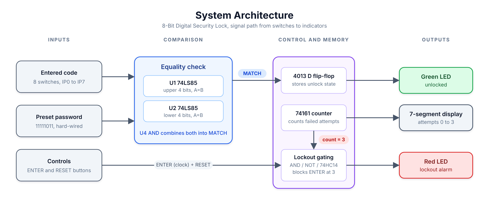
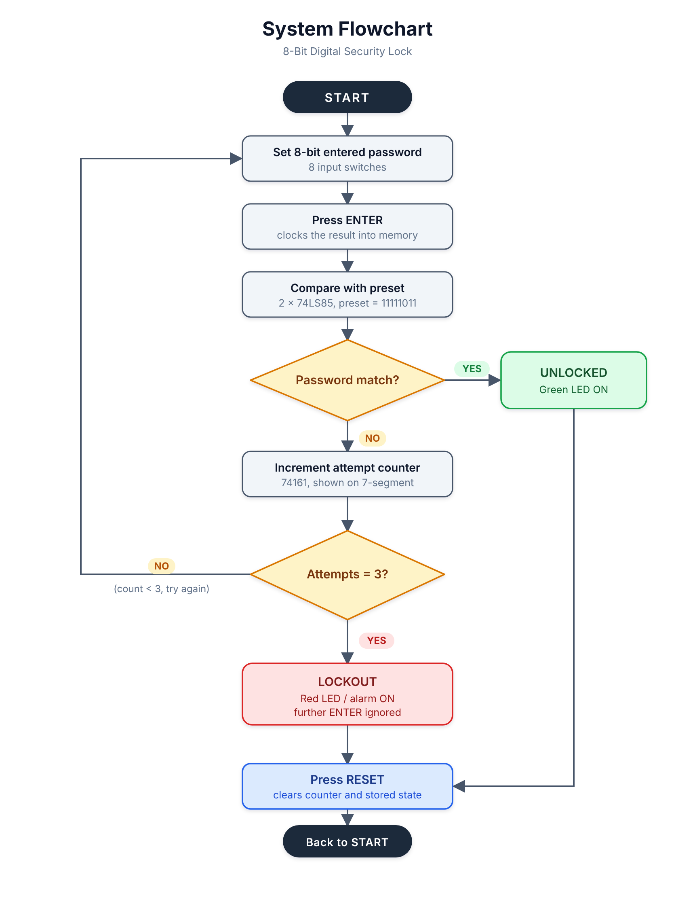
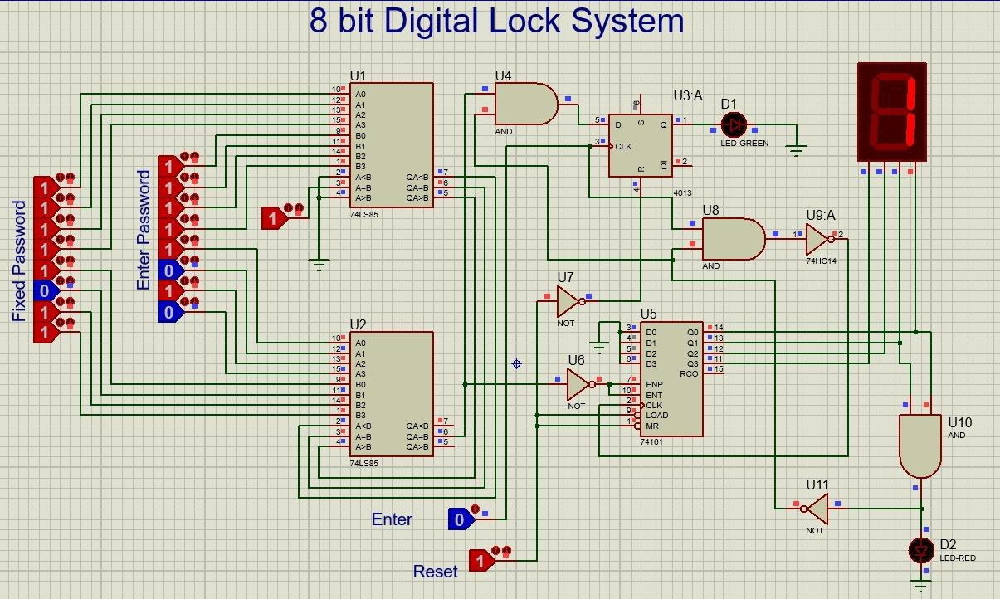
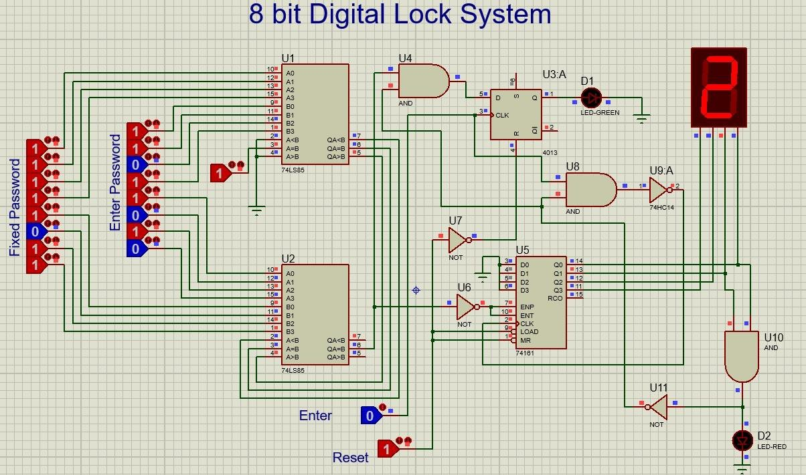
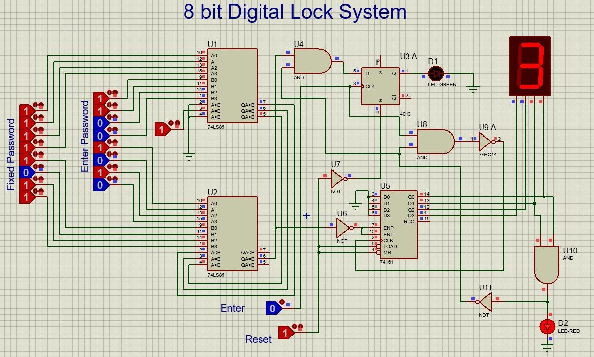
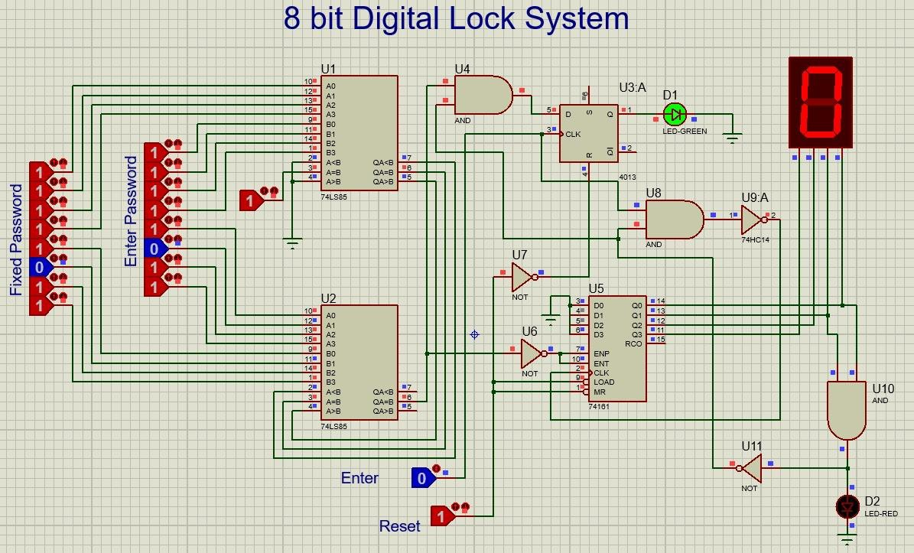

# 8-Bit Digital Security Lock System

**A discrete-logic combination lock with attempt counting, automatic lockout and reset, designed and simulated in Proteus 8.**

> Originally a term project for **EEE283: Digital Logic Design** at BRAC University. This repository contains the circuit design that I built. It is a simulation-only project; no hardware was built.

---

## Overview

This project implements an 8-bit binary security lock using only standard digital ICs. There is no microcontroller and no software. The user sets an 8-bit code on a bank of switches and presses **ENTER**; the circuit compares it with a hard-wired password, then either unlocks, counts a failed attempt, or locks out after three failures. A dedicated **RESET** input returns the system to its initial state.

The design shows how combinational logic (comparison), sequential logic (state memory and counting) and simple control gating combine to form a complete, observable security application.

## Features

| Feature | Implementation |
|---|---|
| 8-bit binary password | 8 input switches compared against 8 fixed logic levels |
| Unlock indication | Green LED driven by a stored flip-flop state |
| Failed-attempt counter | 4-bit counter shown on a 7-segment display (0 to 3) |
| Automatic lockout | Red alarm LED at the third wrong attempt; further ENTER presses are ignored |
| Reset | Single RESET input clears the counter and stored state after unlock or lockout |
| Clean control signals | Schmitt-trigger inverter and defined logic levels in the control path |

## Password Selection

The password is derived from the group number as the 8-bit two's complement of that number.

| Step | Value |
|---|---|
| Group number | 5 |
| 8-bit binary | `00000101` |
| One's complement (invert bits) | `11111010` |
| Two's complement (add 1) | `11111011` |
| **Preset password** | **`11111011`** |

## System Architecture

  

The design is split into four stages: inputs, comparison, control and memory, and outputs. This mirrors the Proteus schematic, so the signal path from the switches to the indicators is easy to trace.

## Flowchart

  

## Circuit Description

| Block | Component | Role |
|---|---|---|
| Comparison | 2 x **74LS85** (U1, U2) | Each chip compares one 4-bit half of the entered code with the preset password and outputs A=B |
| Match logic | **AND** gate (U4) | `MATCH = EQ_upper AND EQ_lower`, which is HIGH only when all 8 bits are identical |
| State memory | **4013** D flip-flop (U3:A) | Samples `MATCH` on ENTER and holds the unlocked state, driving the green LED |
| Attempt counter | **74161** 4-bit counter (U5) | Counts failed attempts in binary and feeds the display and lockout logic |
| Lockout and control | AND / NOT gates, **74HC14** | Detects count `0011`, drives the red LED and blocks further ENTER processing |
| Indicators | Green LED, red LED, 7-segment display | Unlock status, lockout alarm, attempt count |

**Why this structure.** The comparator output is purely combinational and changes whenever the switches change, so it cannot serve as a lock state by itself. The flip-flop captures the result at the moment ENTER is pressed, and the counter keeps a history of failures. Splitting the 8-bit compare into two 4-bit stages also makes troubleshooting easy: a mismatch can be traced to either the upper or the lower half.

## Operation

1. Set the 8 *Enter Password* switches.
2. Press **ENTER**. The 74LS85 comparators evaluate the code against `11111011`.
3. **Correct code:** `MATCH` goes HIGH, the 4013 stores the unlocked state and the **green LED** turns on.
4. **Wrong code:** `MATCH` stays LOW, the 74161 increments and the display shows **1**, then **2**.
5. **Third wrong code:** the counter reaches `0011`, the **red LED** turns on and further ENTER presses are ignored.
6. Press **RESET** at any time to clear the counter and stored state and start again.

## Simulation Results

| Test condition | Display | LEDs | Interpretation |
|---|---|---|---|
| Power-on / RESET | 0 | Both OFF | Ready for a new attempt |
| Wrong password, attempt 1 | 1 | Both OFF | First failure counted |
| Wrong password, attempt 2 | 2 | Both OFF | Second failure counted |
| Wrong password, attempt 3 | 3 | **Red ON** | Lockout activated |
| Correct password `11111011` | 0 | **Green ON** | Lock opened |
| RESET after unlock or lockout | 0 | Both OFF | System restored |

<table>
  <tr>
    <td align="center"><b>Wrong attempt 1</b></td>
    <td align="center"><b>Wrong attempt 2</b></td>
  </tr>
  <tr>
    <td></td>
    <td></td>
  </tr>
  <tr>
    <td align="center"><b>Wrong attempt 3: lockout</b></td>
    <td align="center"><b>Correct password: unlocked</b></td>
  </tr>
  <tr>
    <td></td>
    <td></td>
  </tr>
</table>

## Getting Started
Requirements: Proteus 8 (ISIS).

1. Clone or download this repository.
2. Download and extract the **[Proteus Simulation Files (.zip)](./proteus/proteus-simulation.zip)**.
3. Open `lock-system.pdsprj` inside Proteus 8.
4. Click **Run the simulation** (play button).
5. Set the Enter Password switches and press ENTER.
   - Enter `11111011` to see the green LED turn on.
   - Enter any other value three times to reach count 3 and trigger the red LED.
6. Press RESET to restore the system.

## Documentation

- 📄 **Full Project Report:** Click to view the complete term project report **[View PDF](./report/lock-system-report.pdf)**.
- ⚡ **Proteus Project Archive:** Download all schematic and simulation files **[Download ZIP](./proteus/proteus-simulation.zip)**.

## Limitations and Future Work

- The password is hard-wired, so changing it means changing the fixed logic levels in the schematic.
- Mechanical switch bounce is not modelled; a hardware build would need debouncing on ENTER and RESET.
- The lock has no timed re-enable, so only RESET clears a lockout.
- Possible extensions: a user-programmable password using registers or memory, keypad entry, and a buzzer for the alarm.

## Notes

- This is an educational simulation project and **not** a real security product.
- Shared for portfolio and learning purposes. If you are a current student, please do not submit this work as your own.
